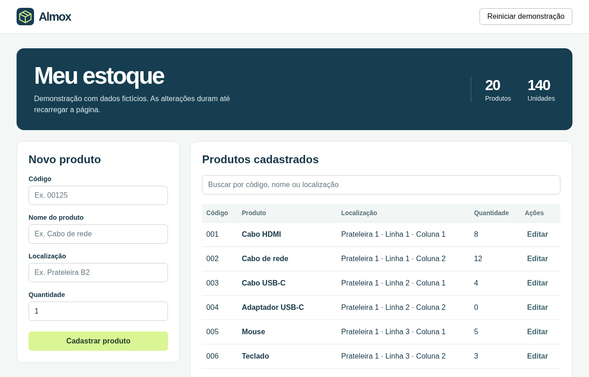

# Almox · Controle de estoque

Aplicação de inventário para um almoxarifado de duas prateleiras. A pessoa que separa um pedido pode procurar um código, encontrar a linha e a coluna do produto e conferir quantas unidades estão disponíveis. A aplicação usa **PostgreSQL no Supabase**, autenticação por e-mail e uma interface em **HTML, CSS e JavaScript**.

**[Baixar a demonstração interativa](https://github.com/pbzino/banco-de-dados/raw/refs/heads/main/demonstracao.html)**. Abra o HTML baixado no navegador. Ele funciona offline e traz 20 produtos fictícios. Procure por `001`, clique em **Movimentar** e registre uma entrada de cabo HDMI. O total de unidades acompanha a alteração. **Reiniciar demonstração** restaura os dados de exemplo.



## Como os dados foram modelados

Uma conta possui vários produtos. Cada registro de produto guarda um saldo e uma localização. A carga de exemplo distribui 20 produtos em duas prateleiras de cinco linhas e três colunas, deixando a terceira coluna de cada linha disponível.

| Decisão | Motivo |
| --- | --- |
| UUID como chave primária e código comercial em texto | Um produto pode mudar de código e manter sua identidade. O código `001` preserva os zeros à esquerda. |
| Índice único em `(proprietario, upper(codigo))` | Impede cadastrar `ABC` e `abc` na mesma conta. Contas distintas podem usar o mesmo código. |
| Quantidade inteira com `CHECK (quantidade >= 0)` | Aceita produto esgotado e impede gravar saldo negativo diretamente no banco. |
| Chave estrangeira e segurança por linha (RLS) | O proprietário referencia `auth.users`. O PostgreSQL verifica a conta autenticada em cada leitura, inserção e edição. |
| Verificação dos valores anteriores ao editar | Se outro acesso já alterou o cadastro, a interface pede que o usuário confira o saldo antes de gravar por cima. |

A localização é texto livre para acomodar endereços como “Prateleira 1 · Linha 2 · Coluna 1”. Esse modelo atende um local por produto. Dividir o mesmo item entre vários endereços exigiria uma tabela de posições com saldo por produto e posição. Cada movimentação identifica a conta responsável, o horário, o saldo anterior e o novo. O histórico começa a partir da implantação da migração 003. A quantidade inicial do cadastro é o saldo de abertura.

## SQL para explorar

| Arquivo | O que observar |
| --- | --- |
| [Criação da tabela e políticas de acesso](sql/001_produtos.sql) | Chaves, permissões por coluna, índice único e políticas por operação. |
| [Migração de quantidade](sql/002_quantidade.sql) | Evolução do esquema com valor inicial para produtos já existentes. |
| [Carga dos 20 produtos](sql/exemplos/01_cadastrar_20_produtos.sql) | Geração dos endereços e uso de `ON CONFLICT` para repetir a carga sem duplicação. |
| [Consultas de estoque](sql/exemplos/02_consultas.sql) | Busca por código ou nome, filtro por prateleira, itens esgotados e total de unidades. |
| [Entrada, saída e ajuste de saldo](sql/exemplos/03_alteracoes.sql) | Chamadas à função de movimentação e retirada condicionada ao saldo disponível. |

No SQL Editor, execute um bloco de alteração inteiro, de `BEGIN` até `ROLLBACK`, para conferir o resultado e desfazer o teste. Para efetivar uma operação, finalize o bloco com `COMMIT`. Os exemplos administrativos pressupõem uma única conta ou a seleção explícita do proprietário.

## Verificar as regras do banco

Com Node.js 22 ou superior, execute na raiz do repositório:

```sh
npm ci
npm test
```

Os [testes de integração](testes/estoque.test.js) aplicam as migrações reais em uma instância descartável do PostgreSQL com PGlite. Eles verificam duplicidade de código, isolamento entre contas, bloqueio de leitura anônima, saldo zero e negativo e repetição da carga inicial. O teste simula a identidade fornecida pelo Supabase Auth e exercita as políticas SQL. O login por e-mail é integrado ao serviço hospedado.

## Executar a aplicação com PostgreSQL

1. Em um projeto próprio do Supabase, execute [001_produtos.sql](sql/001_produtos.sql) e, em ordem, [002_quantidade.sql](sql/002_quantidade.sql) e [003_movimentacoes.sql](sql/003_movimentacoes.sql) no SQL Editor.
2. Crie e confirme um usuário em **Authentication → Users**. Para restringir o cadastro de novas contas, ajuste as opções de autenticação do projeto.
3. Configure a URL do seu projeto e a chave **publicável** em [docs/config.js](docs/config.js). A senha do banco e as chaves administrativas devem ficar fora do navegador e do repositório.
4. Na raiz, execute `python -m http.server 8000 --directory docs`, abra **http://localhost:8000** e entre com o usuário criado. Opcionalmente, após criar a conta, execute o script de carga para começar com os 20 exemplos.

Para hospedar a interface no GitHub Pages, selecione a branch principal e a pasta `/docs` em **Settings → Pages**. Os registros permanecem no PostgreSQL. Para reconstruir o HTML portátil após editar a interface, execute `node scripts/gerar-demo.js`.

## Movimentar um produto

Clique em **Movimentar** na linha do produto. Use **Entrada** para receber unidades, **Saída** para retirar e **Ajuste de inventário** para informar o saldo contado e o motivo. O diálogo mostra as últimas 50 movimentações na base online. A função PostgreSQL bloqueia a linha do produto enquanto valida o saldo, atualiza a quantidade e grava o histórico na mesma transação. Cada solicitação usa um UUID para evitar duplicação em uma repetição. O modelo de contas continua individual.
